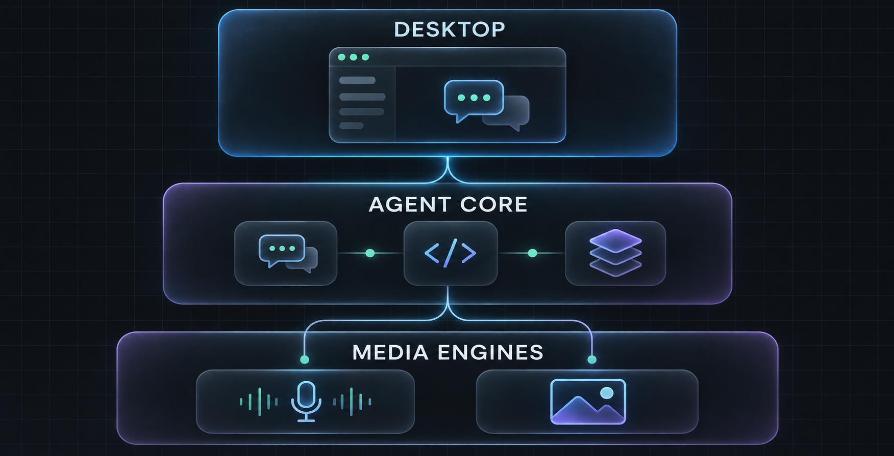

# Skai Desktop


**A local-first desktop workspace for chat, coding agents, models, projects, and media workflows.**

Skai Desktop is being shaped into a serious desktop AI workspace: private by default, useful with local runtimes, and extensible enough to connect hosted providers, coding agents, image engines, and future real-time voice systems.

> **Status:** active migration. The Uno/.NET desktop app is the current functional product. An Electron + React + TypeScript shell and persistent .NET agent-host seam are now checked in as the next product surface. The replacement UI is not yet feature-parity complete.

## What is here today

| Surface | What it provides |
| --- | --- |
| Native desktop | Uno Platform + C# app targeting shared Skia desktop and Windows App SDK. |
| Chat | Streaming OpenAI-compatible conversations, local persistence, attachments, opt-in web search, and slash actions. |
| Coding Agent | Bounded project context, reviewable file changes, guarded undo, project terminal, and GitHub commit/push integration. |
| Model Library | Discovery across common local hosts, compatible endpoints, Hugging Face search, and bounded downloads. |
| Local media | ComfyUI-compatible image workflows plus local ONNX task pipelines where the model/runtime is compatible. |
| Desktop migration | Electron shell, React renderer, typed contracts, secure preload boundary, and .NET agent-host protocol v1. |



## Architecture direction

The migration is incremental. The working native app remains available while the new desktop surface grows around a durable execution core.

```text
Electron desktop
  React + TypeScript · navigation · chat · coding · media · workflows
            │ typed, sandboxed local boundary
            ▼
.NET agent host
  sessions · routing · task execution · permissions · persistence
            │ adapters
            ▼
Providers and engines
  OpenAI-compatible APIs · Ollama · LM Studio · ComfyUI · MCP/agent integrations
```

The current migration checkpoint is documented in [`docs/ELECTRON_MIGRATION_STAGE1.md`](docs/ELECTRON_MIGRATION_STAGE1.md). The native application architecture and release constraints are in [`docs/ARCHITECTURE.md`](docs/ARCHITECTURE.md), [`docs/NATIVE_MIGRATION.md`](docs/NATIVE_MIGRATION.md), and [`docs/PRODUCTION_READINESS_GAPS.md`](docs/PRODUCTION_READINESS_GAPS.md).

## Run the current native app

Prerequisites: .NET 10 SDK. On Linux, install the GTK 3 and graphics dependencies required by [Uno Platform](https://platform.uno/docs/articles/get-started-with-linux.html).

```sh
dotnet build native/ServerRock.Native/ServerRock.Native.csproj -f net10.0-desktop
dotnet run --project native/ServerRock.Native/ServerRock.Native.csproj -f net10.0-desktop
dotnet run --project native/ServerRock.Core.Tests/ServerRock.Core.Tests.csproj
```

The app stores conversations and non-secret settings in the platform application-data directory. Provider credentials use the platform credential mechanism where supported. There is no analytics or telemetry.

## Run the new desktop shell

The Electron surface is a migration prototype with a live health handshake to the .NET host.

```sh
npm run desktop:install
npm run desktop:typecheck
npm run desktop:build
npm run desktop:dev
```

The renderer runs with context isolation, no Node integration, a restricted preload API, and a renderer content-security policy. The host protocol accepts JSON-lines requests such as `runtime.health` and keeps execution independent of a particular screen.

## Core capabilities

- Local-first chat with configurable OpenAI-compatible providers.
- Model discovery for Ollama, GPT4All, LM Studio, Jan, LocalAI, llama.cpp, vLLM, KoboldCpp, Text Generation WebUI, and compatible cloud endpoints.
- Coding-agent workflows with project-scoped context, approval before writes, bounded terminal sessions, cancellation, and undo history.
- Optional web search through DuckDuckGo when explicitly enabled.
- Slash actions including `/fast`, `/plan`, `/goal`, `/status`, `/imagegen`, `/review`, `/summarize`, `/explain`, `/translate`, `/models`, `/clear`, and `/help`.
- Voice dictation and opt-in spoken responses through native Windows speech services.
- ComfyUI-compatible image generation and local ONNX task pipelines for compatible models.
- User-initiated native release checks with SHA-256 verification and signed Core manifest support.

Not every model can run in every runtime. Architecture, weights, dependencies, hardware, access gating, license, and provider compatibility still determine what is usable.

## Privacy and safety posture

- No background telemetry or account-cookie import.
- Cloud providers receive only the content you explicitly submit to them.
- Local project reads are bounded; common dependency/secret folders and symbolic links are excluded.
- File writes require explicit approval and maintain guarded undo history.
- Downloads and release updates are user initiated and bounded.
- Windows 8 support is unresolved because the current .NET 10 target does not support it; do not treat a successful build as a compatibility guarantee.

See [`docs/CAPABILITY_MATRIX.md`](docs/CAPABILITY_MATRIX.md) for the current support truth and [`docs/NATIVE_RELEASE_ACCEPTANCE.md`](docs/NATIVE_RELEASE_ACCEPTANCE.md) for release gates.

## Repository map

```text
apps/desktop/             Electron + React migration surface
services/agent-host/      Persistent .NET host and protocol boundary
native/ServerRock.Core    UI-independent application and provider logic
native/ServerRock.Native  Current Uno/XAML desktop application
docs/                     Architecture, capability, release, and feature docs
assets/branding/          Product visuals used by the repository presentation
.github/workflows/        Native CI, artifacts, acceptance, and release workflows
```

Useful documentation:

- [`docs/FUTURE_FEATURES.md`](docs/FUTURE_FEATURES.md) — feature backlog and product direction.
- [`docs/MODEL_LIBRARY.md`](docs/MODEL_LIBRARY.md) — model discovery and runtime limits.
- [`docs/LOCAL_IMAGE_GENERATION.md`](docs/LOCAL_IMAGE_GENERATION.md) — ComfyUI and local media setup.
- [`docs/GITHUB_INTEGRATION.md`](docs/GITHUB_INTEGRATION.md) — project GitHub workflows.
- [`docs/GOAL_EXECUTION.md`](docs/GOAL_EXECUTION.md) — bounded goal execution behavior.
- [`services/agent-host/README.md`](services/agent-host/README.md) — host protocol details.

## Contributing

Keep migration work incremental and testable. Preserve the native app until the Electron replacement has real parity. Before opening a change, run the focused checks relevant to the files you touched:

```sh
npm run check:syntax
npm run check:hygiene
npm test
npm run desktop:typecheck
npm run desktop:build
```

The project is released under the [MIT License](LICENSE). Third-party notices are collected in [`THIRD_PARTY_NOTICES.md`](THIRD_PARTY_NOTICES.md).
