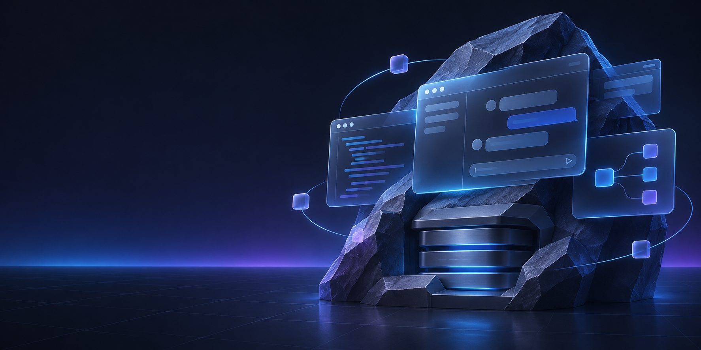

# Skai Desktop

<div align="center">
  
  <h1>Skai Desktop</h1>
  <p><strong>A local-first desktop workspace for chat, coding, projects, models, and media.</strong></p>
  <p>Private by default. Built for real work on your own computer.</p>
</div>

<p align="center">
  
</p>

Skai Desktop brings conversations, local models, project files, guarded terminal work, GitHub workflows, and creative tools into one Windows desktop application. It is designed to feel like a focused workbench rather than another chat tab.

## What Skai is today

- **Local chat** with Ollama, LM Studio, LocalAI, llama.cpp, vLLM, and other OpenAI-compatible servers running on this computer.
- **AirLLM support** for running very large models locally when ordinary local capacity is not enough.
- **Coding Workspace** with project-scoped folders, file preview and editing, reviewable diffs, guarded terminal commands, undo, and task planning.
- **Local scheduled automations** with durable prompts, one-time or repeating schedules, pause/resume/cancel controls, and run-now actions; execution remains explicit until the local executor is enabled.
- **Conversation workspace** with persistent history, attachments, queued follow-ups, Markdown/code rendering, retry, fork, pin, archive, and rename actions.
- **Local media workflows** through ComfyUI-compatible image generation and supported native voice features.
- **GitHub project workflows** for repository context and guarded review/commit/push actions. GitHub is a project integration, not a model runtime.
- **Percy**, the Skai wolf mascot and optional local companion.

## No-cloud product boundary

Skai Desktop does **not** use hosted model providers, cloud model execution, cloud sync, or remote model routing. Model prompts and attachments stay on this computer and are sent only to a local runtime that you configure.

External integrations such as GitHub are separate, user-initiated project workflows. They never become a model route or an automatic fallback.

## Why Skai

| Skai Desktop | Typical AI chat app |
| --- | --- |
| Local models in one discoverable library | One provider and disconnected tools |
| Project-scoped context, files, terminal, and task review | Copy and paste between chat, editor, and terminal |
| Persistent local conversations and drafts | Account-first history with opaque data flows |
| Bounded reads and explicit write approval | Broad tool access with limited review |
| Chat, coding, models, images, memory, and settings in one shell | Separate apps for separate steps |

## Architecture

```text
Electron + React + TypeScript
        │ typed, sandboxed local IPC
        ▼
.NET Agent Host
        │ sessions · local providers · tools · persistence
        ▼
Ollama · LM Studio · AirLLM · local OpenAI-compatible APIs · ComfyUI
```

The Electron renderer is the product UI. The isolated preload bridge exposes only typed desktop operations. The persistent .NET Agent Host and shared Core services own local model requests, project boundaries, persistence, approvals, and guarded file/terminal operations. The older Uno/XAML surface remains only as migration compatibility code.

## Run locally

Prerequisites:

- Windows 10/11
- .NET 10 SDK
- Node.js 20+
- A local model runtime such as Ollama or LM Studio (optional for UI work)

```sh
# Install desktop dependencies
npm run desktop:install

# Start the Electron + React desktop app
npm run desktop:dev

# Run the native Core checks
dotnet run --project native/SkaiDesktop.Core.Tests/SkaiDesktop.Core.Tests.csproj
```

## Verification

Before opening a pull request, run the checks that match your change:

```sh
npm run check:syntax
npm run check:hygiene
npm run audit:electron-runtime
npm run audit:local-only
npm test
npm run desktop:typecheck
npm run desktop:build
```

The local-only audit is intentional: it rejects hosted/cloud model routes from the shipped Electron and Agent Host runtime.

## Repository map

```text
apps/desktop/              Electron + React desktop surface
services/agent-host/       Persistent .NET host and protocol boundary
native/SkaiDesktop.Core/   Local provider, persistence, workflow, and safety logic
native/ServerRock.Native/  Legacy Uno/XAML compatibility surface during migration
assets/                    Skai branding and Percy mascot assets
docs/                      Architecture, capability, release, and feature documentation
```

Useful docs:

- [`docs/SKAI_PREMIUM_UI_PROGRESS.md`](docs/SKAI_PREMIUM_UI_PROGRESS.md) — visual migration ledger and evidence.
- [`docs/FUTURE_FEATURES.md`](docs/FUTURE_FEATURES.md) — future product backlog.
- [`docs/CAPABILITY_MATRIX.md`](docs/CAPABILITY_MATRIX.md) — implemented, partial, and planned capabilities.
- [`docs/ELECTRON_MIGRATION_CUTOVER.md`](docs/ELECTRON_MIGRATION_CUTOVER.md) — Electron replacement boundary and retirement gates.
- [`docs/GITHUB_INTEGRATION.md`](docs/GITHUB_INTEGRATION.md) — repository project workflows.
- [`services/agent-host/README.md`](services/agent-host/README.md) — Agent Host protocol notes.

## Current status

The Electron + React + TypeScript surface is the active product and is being advanced through verified UI and runtime slices. The current workbench includes local task planning and durable scheduled-automation controls, while the Uno application is retained only as a compatibility surface during migration. The project is actively under development; unsupported capabilities should not be assumed to be shipped.

## Contributing

Keep changes incremental, local-first, and testable. Preserve the Electron → isolated IPC → .NET Agent Host boundary, avoid exposing secrets to the renderer, and do not add cloud model routes.

MIT licensed. Third-party notices are in [`THIRD_PARTY_NOTICES.md`](THIRD_PARTY_NOTICES.md).
