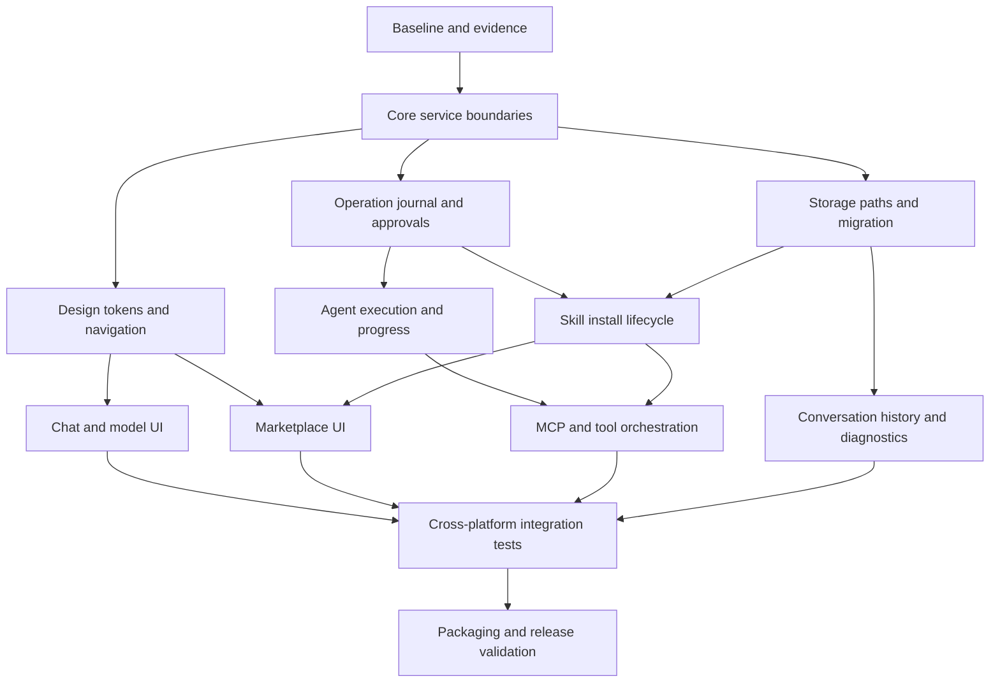

# Feature dependency graph

## Gate definitions
- Before moving storage: inventory and backup, migration fixtures and rollback tests.
- Before auto-selecting skills: stable manifests, permissions, provenance and safe installer.
- Before parallel UI implementation: shared view models and navigation contracts.
- Before releasing: end-to-end workflows on Windows and Linux, upgrade/uninstall and credential redaction verified.
- Independent branches may proceed in parallel only where contracts and file ownership are nonoverlapping.
